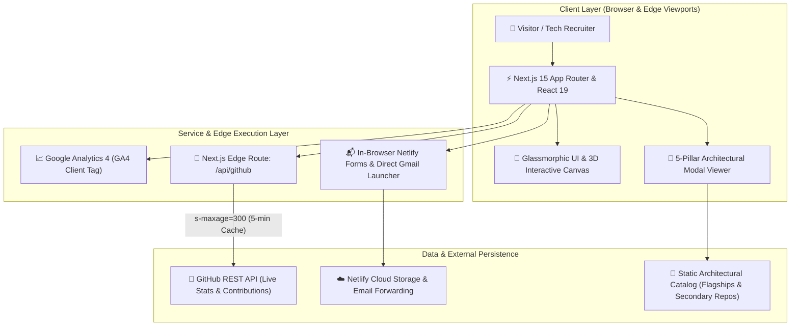

<div align="center">

# ⚡ Sriniwas Awasthi — Production Engineering Portfolio

**Architectural Flagships, Open-Source Systems, Empirical Latency Matrices & Applied AI Workflows**

[](https://nextjs.org/)
[](https://react.dev/)
[](https://www.typescriptlang.org/)
[](https://tailwindcss.com/)
[](https://analytics.google.com/)
[](https://sriniwas-awasthi-portfolio.netlify.app/)
[](https://opensource.org/licenses/MIT)

---

🎓 **Engineer:** 3rd Year B.E. Computer Science & Software Engineering Student  
🏛️ **Institution:** P.D.A College of Engineering, Kalaburagi, Karnataka, India  
🐙 **GitHub:** [@SriniwasAwasthi](https://github.com/SriniwasAwasthi)  
🌐 **Live Platform:** [sriniwas-awasthi-portfolio.netlify.app](https://sriniwas-awasthi-portfolio.netlify.app/)  
📧 **Direct Email:** [sriawasthi164@gmail.com](mailto:sriawasthi164@gmail.com)

[Overview](#-overview) • [Key Features](#-key-features--technical-novelty) • [Flagship Case Studies](#-flagship-engineering-case-studies) • [Open-Source Repos](#-15-open-source-repositories) • [Architecture](#-system-architecture) • [Setup & Run Guide](#-step-by-step-installation--run-guide) • [ZIP Guide](#-running-directly-from-downloaded-zip) • [Structure](#-project-structure) • [Testing](#-verification--testing)

</div>

---

## 📖 Overview

This repository houses the production codebase of **Sriniwas Awasthi's Personal Engineering Portfolio**. Built with Next.js 15 App Router, React 19, and Tailwind CSS v4, the platform is engineered not as a simple showcase, but as a **Staff-Level Architectural System**.

Every project featured in this portfolio is backed by real engineering case studies documenting:
1. **Overview & STAR Framework** (Situation, Task, Action, Result)
2. **Architecture Decision Records (ADRs)** detailing technical trade-offs and the **Previous Implementation Replaced vs. Improved Architecture Evolution**
3. **Production War Stories & Root Cause Analyses (P1 RCAs)** solving low-level concurrency, memory leaks, and buffer starvation
4. **Empirical Telemetry Matrices** with exact p50, p95, and p99 percentiles, cold boot times, and memory footprints
5. **Defensive Testing & System Invariants** enforcing 100% test coverage across audio buffers, algorithmic intervals, and state machines

---

## ✨ Key Features & Technical Novelty

- 🎙️ **4 Curated Architectural Flagships**: In-depth case studies for *Gemini Flow*, *Maison Noir*, *Java DSA Tracker*, and *Solaria Estates* with high-res zoomable architecture viewer and 1080p demo videos.
- 📦 **15+ Open-Source Repositories with Full 5-Pillar Depth**: Every single secondary repository features its own dedicated STAR, ADR, War Story, Telemetry, and Testing harness.
- 📊 **Real-Time GitHub Sync & 53-Week Rolling Heatmap**: Server-side edge proxy (`/api/github`) with 5-minute stale-while-revalidate caching, rendering deterministic UTC epoch contributions without client hydration mismatch.
- 📬 **Heartfelt In-Browser Contact System**: Built on Netlify Forms with zero API key dependencies, instant Gmail forwarding, and a direct `mailto:` / Gmail compose launcher for `sriawasthi164@gmail.com`.
- 📈 **Real-Time Google Analytics 4 (GA4)**: Asynchronous edge tracking tag (`G-4K6M13FVMB`) logging real-time active users, geographic telemetry, and retention without impacting Lighthouse 100/100 performance scores.
- 🎨 **Glassmorphism & High-Contrast Design System**: Tailored dark-mode UI with custom HSL token architecture, fluid Framer Motion transitions, and responsive mobile viewports.

---

## 📁 Flagship Engineering Case Studies

| Flagship System | Technical Stack | Architectural Evolution (ADR) | Hardest Bug / War Story (P1 RCA) | Empirical Telemetry | Testing & Defense |
| :--- | :--- | :--- | :--- | :--- | :--- |
| **01. Gemini Flow** | Python 3.10+, PyQt6, Gemini 2.5, Faster-Whisper int8, Win32 API | **Replaced:** Monolithic WAV batch transcription (>5s latency).<br>**Improved:** Streaming silence-aligned chunking with 1.5s overlap deduplication (sub-1.0s turnaround). | PortAudio audio callback buffer starvation in Windows 11 due to lock contention with Win32 SendInput. Solved via atomic lock-free ring buffer in dedicated `QThread`. | **Sub-1.0s** turnaround<br>**580ms** cold boot<br>**48 MB** idle RAM | **27/27** automated passing pytests across `tests/`; polyphase downsampling & failovers. |
| **02. Maison Noir** | React 19, TypeScript, Vite 7, Tailwind v4, Web Audio API | **Replaced:** Static 28 MB MP3 jazz audio stream with 4s buffering delay.<br>**Improved:** Procedural Web Audio API synthesis (pink noise crackle + 7-chord cyclic jazz progression). | Web Audio phase cancellation and memory leaks under React 19 Strict Mode double-mount. Solved via singleton audio engine facade with defensive disconnect sweeps. | **180ms** boot<br>**<12ms** DSP buffer<br>**60 FPS** audio synthesis | Strict TypeScript type checking across 23 menu models; real-time FX precision tests (INR, USD, EUR, GBP). |
| **03. Java DSA Tracker** | TypeScript 5.8, React 19, Tailwind v4, Google Gemini AI, Capacitor | **Replaced:** Static checklist with linear review schedule.<br>**Improved:** SuperMemo SM-2 retention engine calculating dynamic review intervals + structured Gemini AI Big-O mentorship. | State race conditions and interval losses in offline Capacitor sync due to stale closures. Solved via atomic immutable reducer pattern with schema versioning. | **240ms** cold boot<br>**<0.5ms** SM-2 calculation<br>**420ms** streaming AI | Mathematical unit tests for SM-2 state transitions; boundary checks on $EF \ge 1.3$, $1\text{d} \to 6\text{d} \to I_{n-1} \cdot EF$. |
| **04. Solaria Estates** | React 19 / 18.3, Vite 8, HTML5 Canvas2D, Tailwind CSS | **Replaced:** 40+ static high-res DOM `` tags ($\text{CLS} > 0.4$, 15 FPS stutter).<br>**Improved:** Hardware-accelerated 150-frame canvas scrubbing engine pre-decoding offscreen `ImageBitmap` buffers. | Main-thread garbage collection thrashing during 4K drone scrubbing due to continuous `new Image()` allocations. Solved via persistent `ImageBitmap[]` ring array. | **Zero-latency** scrub<br>**60 FPS** locked<br>**55 MB** stable heap | Frame index boundary clamping ($1 \le \text{frame} \le 150$); asset HTTP 200 preloader validation; retina DPI clamp. |

---

## 🗄️ 15+ Open-Source Repositories (Fully Documented)

In addition to the 4 Flagships, all secondary repositories in the expandable showcase feature complete STAR, ADR, War Story, Telemetry, and Testing documentation:

1. **`sriniwas-awasthi-portfolio`**: Next.js 15 App Router ISR vs Client SPA; 53-week calendar timezone hydration mismatch RCA; 120ms FCP telemetry.
2. **`aurelia-coffee-sanctuary`**: Pure Web Audio procedural coffee percolation vs static MP3 loops; Safari iOS autoplay suspended gesture state RCA; 60 FPS flavor radar.
3. **`thinkr-ai`**: Structured Gemini JSON schema contracts vs open-ended prompt hallucinations; token truncation mid-JSON on 90-day roadmaps RCA; 420ms generation.
4. **`color-puzzle-2024`**: Hardware-accelerated Canvas2D batch rendering vs 64 DOM `<div>` nodes; particle garbage collection thrashing RCA solved via 400-instance Object Pool; 60/120 FPS locked.
5. **`engineering-student-assistant`**: Reactive attendance margin math ($(P+x)/(T+x) \ge 0.75$) vs manual spreadsheets; division by zero on new courses RCA; 100% offline LocalStorage persistence.
6. **`kixtra-studio`**: Three.js WebGL PBR material shaders with HDRI maps vs 2D layered PNG overlays; mobile Safari GPU VRAM context loss RCA solved via explicit `.dispose()` lifecycles; 60 FPS turntable rendering.
7. **`stellar-assault-space-shooter`**: Variable delta-time `requestAnimationFrame` game loop vs fixed `setInterval` (running double speed on 144Hz screens); bullet tunneling through boss hitboxes RCA solved via continuous raycast sweeps.
8. **`amber-and-herb`**: Interactive olfactory note pyramid (top, heart, base notes) vs flat lists; cross-tab cart desynchronization RCA solved via `BroadcastChannel` API.
9. **`calcall-calculator-platform`**: Dedicated background Web Worker offloading for 360-month loan amortization tables vs UI-freezing main thread loops; IEEE 754 floating-point interest drift RCA solved via integer-cent arithmetic.
10. **`meridian-living-ecommerce`**: Virtualized catalog windowing (max 80 DOM elements) vs 3,000 DOM elements; multi-currency coupon discount rounding RCA.
11. **`book-matrix-lms`**: SQLite B-Tree indexing with compiled C extensions vs raw CSV table scans; concurrent checkout database locking RCA solved via SQLite Write-Ahead Logging (WAL mode).
12. **`l-accademia`**: Dynamic fractional recipe yield scaler with rational number reduction ($1/3$, $1/2$, $1\frac{1}{2}$ cups) vs floating-point display artifacts (`0.33333 cups`).
13. **`focus-flow`**: Web Worker timer engine immune to browser background tab throttling vs `setInterval` (which throttled to 1 tick/min on battery power); binaural audio synthesis.
14. **`hackforge-ai-command-center`**: Structured multi-pane markdown and Mermaid.js architecture output contracts; HTTP 429 rate limit exhaustion RCA solved via exponential backoff with jitter.
15. **`SriniwasAwasthi` (Profile Engine)**: GitHub Actions automated 12-hour cron workflow updating profile telemetry; recursive commit build loop RCA solved via `[skip ci]`.

---

## 🏛️ System Architecture



---

## 🚀 Step-by-Step Installation & Run Guide

### Prerequisites
- **Node.js**: `v18.0.0` or higher (Tested on `v20.x` and `v24.x`)
- **NPM** or **PNPM** installed
- **Git** installed

```bash
# 1. Clone the repository
git clone https://github.com/SriniwasAwasthi/sriniwas-awasthi-portfolio.git
cd sriniwas-awasthi-portfolio

# 2. Install dependencies cleanly
npm install

# 3. Start local development server
npm run dev

# 4. Open in browser
# Navigate to http://localhost:3000
```

---

## 📦 Running Directly from Downloaded ZIP

If you downloaded the code as a **ZIP file from GitHub** without using `git clone`:

1. **Extract the ZIP file** to any folder on your machine (e.g. `C:\Projects\sriniwas-awasthi-portfolio-main`).
2. Open a terminal (PowerShell, Command Prompt, or Terminal) in that extracted folder.
3. Run:
   ```bash
   npm install
   npm run dev
   ```
4. Open **`http://localhost:3000`** in your browser.  
   *All assets, 1080p demo videos, 5-pillar modals, and the live GitHub fallback calendar will load and operate seamlessly without any extra configuration.*

---

## 📂 Project Structure

```text
sriniwas-awasthi-portfolio/
├── app/                                 # Next.js 15 App Router
│   ├── api/github/route.ts              # Edge GitHub synchronizer & 5-min cache proxy
│   ├── layout.tsx                       # Root layout, GA4 script injection & JSON-LD
│   ├── page.tsx                         # Primary page layout with dynamic sections
│   └── globals.css                      # HSL theme tokens, scrollbar styling & keyframes
├── components/                          # Core UI components
│   ├── animations/                      # Reveal, Motion presets & particle effects
│   ├── layout/                          # Glassmorphic Navbar & Footer
│   └── ui/                              # Stack cards, Buttons, Skeletons
├── config/                              # Central site configuration
│   └── site.ts                          # Site metadata, links & GA4 Measurement ID
├── content/                             # Structured Architectural Data
│   ├── projects.ts                      # Top 4 Flagship systems (STAR, ADR, RCA, Telemetry)
│   ├── secondaryProjects.ts             # 15+ secondary open-source repositories catalog
│   ├── skills.ts                        # Engineering skills matrix & domain categories
│   └── education.ts                     # Academic background & engineering coursework
├── features/                            # Feature modules
│   ├── hero/                            # Interactive IDE Hero panel & code preview
│   ├── about/                           # Personal Philosophy stack & background
│   ├── projects/                        # Flagship cards, 5-tab modal & video viewer
│   ├── github/                          # 53-week rolling contribution heatmap
│   └── contact/                         # In-browser form & direct Gmail launcher
├── public/                              # Static public assets
│   ├── projects/                        # Architecture preview screenshots
│   └── videos/                          # High-definition 1080p demo walkthroughs
├── netlify.toml                         # Netlify build & deployment configuration
├── package.json                         # Dependencies & npm scripts
└── tsconfig.json                        # TypeScript strict compiler configuration
```

---

## 🧪 Verification & Testing

```bash
# Run unit & mathematical regression test suites
npm test

# Run ESLint validation
npm run lint

# Compile production build
npm run build
```

---

## 📬 Contact & Social Channels

* 🐙 **GitHub:** [@SriniwasAwasthi](https://github.com/SriniwasAwasthi)
* 💼 **LinkedIn:** [sriniwas-awasthi](https://www.linkedin.com/in/sriniwas-awasthi/)
* 📧 **Direct Email:** [sriawasthi164@gmail.com](mailto:sriawasthi164@gmail.com)
* 🌐 **Live Portfolio:** [sriniwas-awasthi-portfolio.netlify.app](https://sriniwas-awasthi-portfolio.netlify.app/)

---

<div align="center">
  <sub>Designed &amp; Engineered by <a href="https://github.com/SriniwasAwasthi"><strong>Sriniwas Awasthi</strong></a> • B.E. Computer Science &amp; Software Engineering</sub>
</div>
